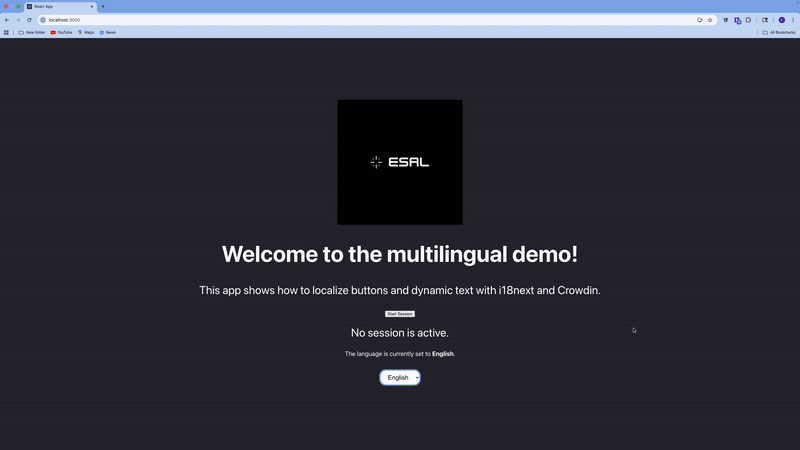
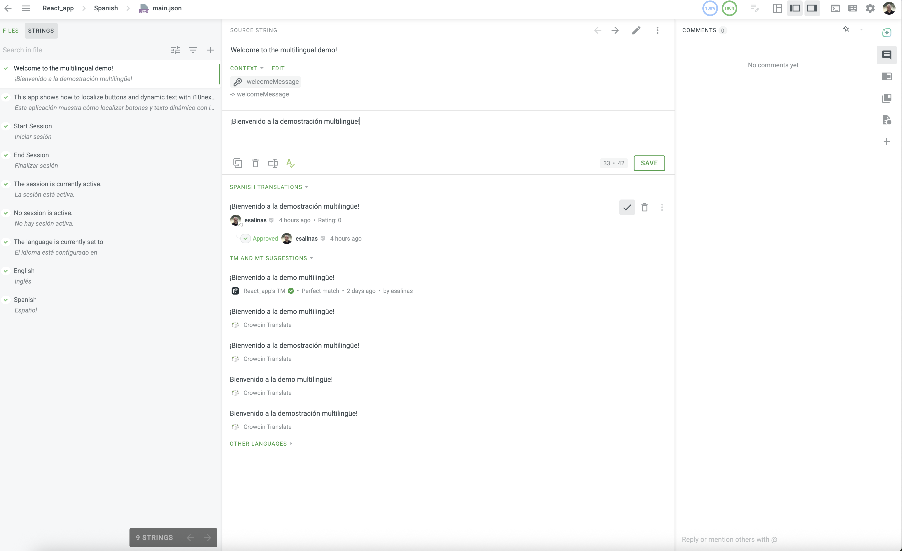
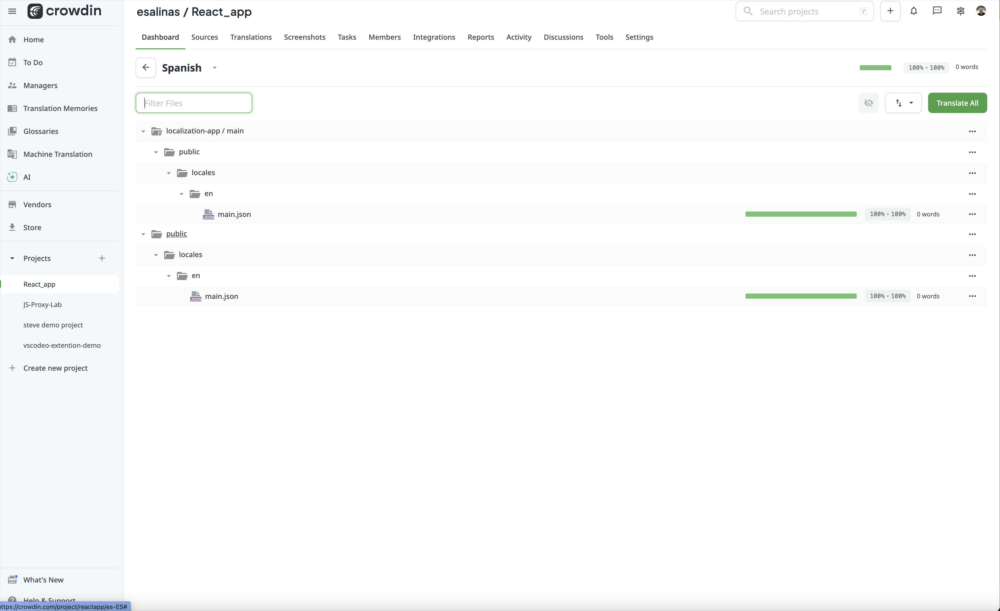
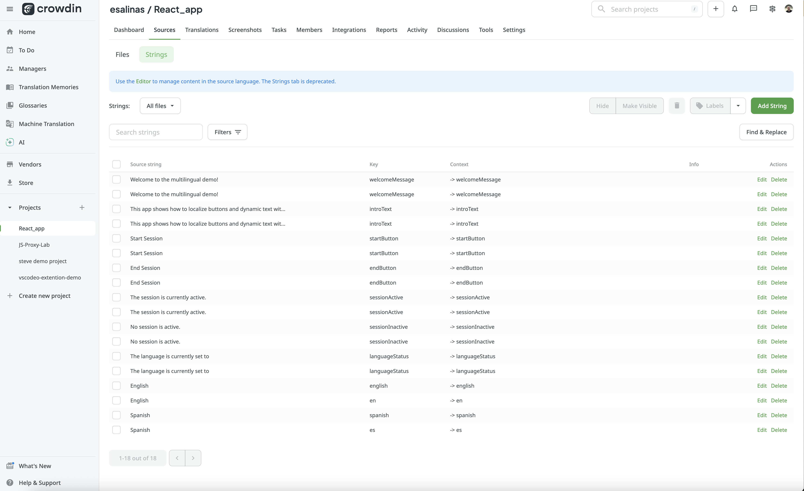

# Localization App Project

## Overview

I used a small English–Spanish React demo to practice working with Crowdin and a GitHub-based localization workflow.

My focus was managing translation strings, reviewing Spanish translations in context, working with JSON language files, and learning how translation updates move between Crowdin and GitHub. The application provided a way to see those translations in the interface.

## 🎬 Demo

Here’s a preview of the localized React application in action:


*The interface dynamically switches between English and Spanish using i18next and Crowdin-managed translation files.*

## Technologies Used

### Localization Stack
- **Crowdin** - Localization and translation management platform
- **i18next** - Internationalization framework
- **react-i18next** - React bindings for i18next
- **i18next-http-backend** - Dynamic translation file loading via HTTP

### Development Stack
- **React** - Frontend framework
- **Create React App** - React application bootstrapping tool
- **JavaScript/JSX** - Programming language with JSX syntax for component rendering
- **Visual Studio Code** - IDE for development
- **npm** - Package management
- **GitHub** - Version control and repository hosting

## Project Structure

```
localization-app/
├── public/
│   └── locales/
│       ├── en/
│       │   └── main.json           # Source English strings (source language)
│       └── es/                     # Spanish translations (approved translation from Crowdin)
│           └── main.json
├── src/
│   ├── App.js                      # Main application with i18n implementation
│   └── App.css
├── crowdin.yml                     # Crowdin configuration file
└── package.json
```

## Localization Workflow

The demo stores English source strings and Spanish translations in separate JSON files.

I used Crowdin to review and edit Spanish translations, working with the source text and checking how the translated strings appeared in the demo.

The project uses a Crowdin–GitHub integration to connect translation work with the repository. The `crowdin.yml` file identifies the English source files and the destination paths for translations.

This exercise helped me understand how translators work with application strings and how localization updates fit into a version-controlled project.

## 🧩 Crowdin Interface Experience

This project included direct interaction with the Crowdin web interface for managing and proofreading translations. The goal was to gain hands-on experience with translation management systems (TMS), machine translation post-editing, and continuous localization workflows.

### Crowdin Screenshots

| Crowdin Section | Description |
|-----------------|--------------|
|  | Working in the Crowdin Translation Editor to review and edit Spanish translations. |
|  | Crowdin project dashboard showing translation progress and GitHub integration status. |
|  | Crowdin project sources. |

*These screenshots illustrate use of the Crowdin platform for translation management, post-editing, and synchronization with GitHub.*

## Skills Practiced

- Working with Crowdin to review and edit Spanish translations
- Navigating source strings and translated strings in a translation management system
- Working with English and Spanish JSON language files
- Understanding how translation keys connect strings to the application interface
- Reviewing translated text in the running demo
- Working with the Crowdin–GitHub integration and translation-update workflow

## Contact

This project demonstrates practical localization experience with industry-standard tools and workflows.

**GitHub Repository**: [https://github.com/e-salinas/localization-app](https://github.com/e-salinas/localization-app)

## License

This project is licensed under the MIT License - see the [LICENSE](LICENSE) file for details.
